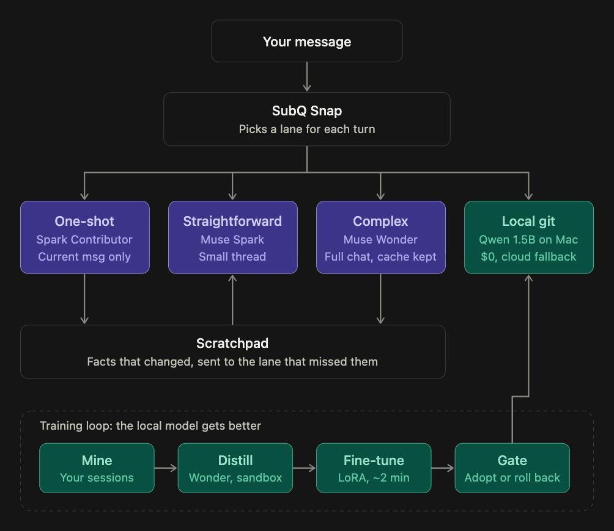

# AIE Hack: SubQ-routed lanes for Pi

Routing thinking effort with SubQ cut Google Gemini Pro costs by **about 18%** ($0.681
versus $0.835 at always-high effort) in a scripted 12-turn coding session. The routed run
scored 11/12, compared with 12/12 at always-high. Always-medium cost $0.679 and scored
11/12, so routing did not beat that fixed-effort baseline.

This is a small experiment, not a general savings guarantee. On Meta, effort routing cost
13% more than always-high. See the [full results](evals/demo/RESULTS.md).

Route each turn of a coding session to the model or effort that fits it, without throwing
away the provider's prompt cache. SubQ Snap classifies every user turn; the router sends it
to a cheap or a strong lane, keeps one append-only thread per lane so cached prefixes stay
warm, and passes facts between lanes through a shared scratchpad.



Design: [docs/PROJECT.md](docs/PROJECT.md) · Illustrated: [docs/lane-architecture.html](docs/lane-architecture.html)

## What else holds up

- **Meta model routing is about break-even.** Lanes $1.282 vs always-Wonder $1.295 (−1%), 11.5/12 vs 12/12; two always-Wonder runs differ by 12% from each other, so that gap is noise. The well-supported figure is per small turn: −65% ($0.092 vs $0.259), 7 of the 12 turns.
- **Cache locality is the point.** Lanes is ~29% cheaper than naive switching ($1.807), the same model choices on one shared thread, losing the cache on every switch. Isolating every lane was worse ($1.647); letting the complex lane keep the full conversation fixed it.
- **It does not pay off everywhere.** With Flash-Lite/Flash/Pro, lanes averaged $1.104 versus $0.679 for always-Pro, about 63% more. Flash is only ~25% cheaper than Pro and needed far more requests in this test.

## The process

SubQ Snap (`subq-snap-1.1`, Decisions API) **classifies** each message `one_shot`,
`straightforward` or `complex` from the conversation and scratchpad, in the background while
the prompt renders, and the label **routes** to a lane in
[extensions/lane-router/mappings.json](extensions/lane-router/mappings.json) — a model, or a
thinking-effort level. Threads stay **append-only**: the `context` hook gives each lane its
own history so cached prefixes never change — one-shot turns see only the current message,
the complex lane sees everything. Lanes **share facts, not context**: the answering model
edits `.lanes/scratchpad.md`, and a lane gets the delta since it last ran as a hidden
prefix. `.lanes/log.jsonl` **logs** the classification and lane per turn and model, tokens,
cache read/write and cost per request — the accounting behind every number.

Evaluation: `run_demo.py` replays the session, `grade_demo.py` scores 5 objective checks (git, tests, answers) plus 7 items an independent judge verifies by driving the app, `costsplit.py` splits per-turn cost.

## Setup

Credentials for SubQ and your provider, plus the Pi sources as submodules.

```bash
git submodule update --init --recursive
printf 'SUBQ_API_KEY=...\nMETA_API_KEY=...\n' > .env
./run.sh --model lanes/auto          # quiet routing
./run.sh --model lanes/auto-verbose  # per turn: lane, model, tokens, cost
LANES_MAPPING=google ./run.sh --model lanes/auto
node scripts/lanes-view.ts          # live view of .lanes/log.jsonl
```

Reproduce: `python3 evals/demo/run_demo.py lanes lanes/auto`, then
`python3 evals/demo/grade_demo.py lanes` (runs land in gitignored `evals/demo/runs/`).

## Caveats

One scripted 12-turn session, one to three runs per setup; per-turn numbers beat totals. Costs are provider-reported plus ~$0.015 router overhead; local compute and some local-lane calls are excluded. Judges differ by run family (Gemini Pro for Meta runs, Muse Wonder for Google runs), so cross-family comparisons are the strong ones. Hard EvoCode-Bench sessions mostly route to the complex lane and show the fix removed a regression, not a saving.

## Layout and links

| Path | Contents |
|---|---|
| `extensions/lane-router/` | Classifier, lane view, scratchpad, mappings, local lane, log |
| `evals/`, `distill/`, `gate/` | Demo + EvoCode-Bench runners; distillation and LoRA gate; SubQ merge-gate experiments |
| `ioi/`, `docs/`, `vendors/` | IOI solutions with checkers; design notes and architecture page; `pi`, `opencode` submodules |

- [Presentation with results](https://claude.ai/artifact/MsLRftvtL428kM6kMcLd82)
- [Video with demo](https://drive.google.com/drive/folders/1eKetSz-5PWnpmOKuiILc7s_lK12ZGBE4)
- Pi: [github.com/earendil-works/pi](https://github.com/earendil-works/pi)
