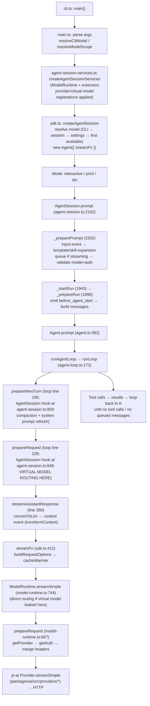

# pi — Message Routing to Models: Reference Documentation

> Scope: how a user turn in [pi](../vendors/pi) (vendored at `vendors/pi/`) reaches a specific model over HTTP, and how to change that behavior.
> All file paths are relative to `vendors/pi/packages/`. Line numbers were verified against the vendored source and are exact as of this writing.

---

## 1. Overview

In pi, **"routing"** has two layers:

1. **Selection** — which model the session is "on". By default pi is a **one-model-per-session** harness: `agent.state.model` holds a single selection, every request of the session uses it, and `/model`, `Ctrl+P` (cycle), and `pi.setModel()` swap it. The selection is persisted to the session transcript as `model_change` entries and restored on resume.
2. **Dispatch (per-request routing)** — the mechanism that decides, for one concrete LLM request, which physical model actually receives it. **Virtual models** are the sanctioned per-request routing mechanism: a catalog entry whose `route()` callback picks a physical model and thinking level for every request. Everything below the routing step — providers, wire APIs, assistant messages — only ever sees physical models.

The key invariant (documented in `coding-agent/src/core/virtual-models.ts:1-11`):

> The selection (`model_change`, `agent.state.model`, `ctx.model`) may name a virtual model. Everything below the routing step only sees physical models: providers stream them and assistant messages record them. A virtual model never reaches a provider.

Two dispatch sites exist:

| Dispatch site | When | Reason passed to router |
|---|---|---|
| `AgentSession._installAgentRequestProjection` (`coding-agent/src/core/agent-session.ts:848`) | Every request inside the agent loop | `user` / `continuation` / `retry` |
| `ModelRuntime.streamSimple` (`coding-agent/src/core/model-runtime.ts:744`) | Requests outside the agent loop (compaction summaries, extension calls via `ctx.modelRegistry.streamSimple`) | `direct` |

---

## 2. Full turn lifecycle trace

### 2.1 Diagram



### 2.2 Step by step

**Startup (once per process)**

| # | What | Where |
|---|---|---|
| 1 | Thin entry: `setupCli(); main(argv)` | `coding-agent/src/cli.ts:1-6` |
| 2 | Parse args (`--model`, `--provider`, `--models`, `--thinking`, `--api-key`, `-p`, `--mode rpc`…). `buildSessionOptions` (`main.ts:498`) resolves the CLI model via `resolveCliModel` (`main.ts:522` → `core/model-resolver.ts:451`) and scoped models via `resolveModelScope` (`main.ts:870` → `model-resolver.ts:417`) | `coding-agent/src/main.ts`, `src/cli/args.ts` |
| 3 | `createAgentSessionServices` (`agent-session-services.ts:135`): creates `ModelRuntime` (or reuses one), loads extensions, then **flushes queued registrations from extension load**: `registerProvider`, `registerNativeProvider`, `registerVirtualModel` (`agent-session-services.ts:158-193`) | `coding-agent/src/core/agent-session-services.ts` |
| 4 | `createAgentSessionFromServices` → `createAgentSession` (`sdk.ts:191`): final model resolution (§3), builds `Agent` with the runtime-bound `streamFn`, appends the initial `model_change` / `thinking_level_change` entries, constructs `AgentSession` | `coding-agent/src/core/sdk.ts` |
| 5 | Mode runs: interactive (`modes/interactive/interactive-mode.ts`), print (`modes/print-mode.ts:33 runPrintMode`), rpc (`modes/rpc/rpc-mode.ts:401 handleCommand`) | `coding-agent/src/modes/` |

**Every user turn**

| # | What | Where |
|---|---|---|
| 6 | Mode calls `session.prompt(text, …)` — print mode at `print-mode.ts:139`, RPC `"prompt"` command at `rpc-mode.ts:409-434` (with `source: "rpc"` and a `preflightResult` callback), interactive editor submit at `interactive-mode.ts:3485` (idle) / `:3497` (steer while streaming) | `coding-agent/src/core/agent-session.ts:2162 prompt()` |
| 7 | `prompt()` handles `/command` extension commands immediately; rejects during compaction; bumps a preflight counter so tree navigation can't race auth checks; then `_preparePrompt` (`agent-session.ts:2202`) | `agent-session.ts` |
| 8 | `_preparePrompt` → `_runInputHandlers` (`agent-session.ts:2111`) → `ExtensionRunner.emitInput` (`extensions/runner.ts:1532`): `input` event handlers may `transform` or `handle` the text. Skill (`/skill:name`) and prompt-template expansion follow. If the agent is streaming, the message is queued as steer/follow-up and returns; otherwise the selected model and its provider auth are validated | `agent-session.ts:2202-2263` |
| 9 | `_startRun` (`agent-session.ts:1943`) → `_prepareRun` (`agent-session.ts:1996`): pre-run compaction check, then `emitBeforeAgentStart` (`extensions/runner.ts:1434`) — the `before_agent_start` event (handlers may edit system-prompt options, append messages, or call `ctx.setModel()`); image normalization happens *after* this so extension-driven model selection picks the resize profile; assembles the starting `user` message + pending nextTurn/handler messages | `agent-session.ts:1996-2047` |
| 10 | `agent.prompt(messages)` (`packages/agent/src/agent.ts:382`) → `runPromptMessages` → `runAgentLoop` (`agent-loop.ts:111`) → `runLoop` (`agent-loop.ts:172`) | `packages/agent/src/agent.ts`, `src/agent-loop.ts` |
| 11 | **Loop, per request:** `config.prepareNextTurn` (`agent-loop.ts:195`) — wired by `AgentSession._installAgentNextTurnRefresh` (`agent-session.ts:959`): compacts before the next assistant response when needed, rebuilds the system prompt/tool loadout, and resets `config.model` back to `agent.state.model` (i.e. back to the *virtual* selection for the next request) | `agent-session.ts:959-993` |
| 12 | `config.prepareRequest` (`agent-loop.ts:228`) — wired by `AgentSession._installAgentRequestProjection` (`agent-session.ts:848`): rebuilds the canonical context from the session projection, chains any previous hook, and **if the selection is a virtual model, routes it** (§4.3). Returns `{ context, model, thinkingLevel }`; the loop copies `model`/`thinkingLevel` into `config` | `agent-session.ts:848-905`, `agent-loop.ts:228-248` |
| 13 | `streamAssistantResponse` (`agent-loop.ts:390`): `transformContext` (the `context` extension event, `sdk.ts:428`), `convertToLlm` (AgentMessage[] → Message[], `sdk.ts:297`), resolves a fresh API key, then calls `streamFn(config.model, llmContext, {…config, apiKey, identity, signal})` (`agent-loop.ts:412`) | `packages/agent/src/agent-loop.ts:390-479` |
| 14 | `streamFn` (`sdk.ts:412`): `buildRequestOptions` (timeouts, retries, telemetry identity, `transformHeaders` → `before_provider_headers` event), starts the cache warmer when the request carries the session id, then **`modelRuntime.streamSimple(model, context, requestOptions)`** | `coding-agent/src/core/sdk.ts:412-423` |
| 15 | `ModelRuntime.streamSimple` (`model-runtime.ts:744`): if the model is somehow still virtual (out-of-loop path), routes with reason `"direct"` (§4.4); otherwise `prepareRequest` (`model-runtime.ts:667`): `getProvider(model.provider)`, `getAuth(model)` (OAuth refresh / API key resolution / configured headers), merges session + auth + provider headers, then `provider.streamSimple(model, transcript, options)` — the **pi-ai Provider makes the HTTP call** | `coding-agent/src/core/model-runtime.ts` |
| 16 | Provider streams events back; the loop emits `message_start/update/end`; tool calls execute (`agent-loop.ts:268-287`); `finishTurn` (turn_end boundary, `agent-session.ts:947`) decides continue/end; steering/follow-up queues are polled; loop repeats from step 11 | `agent-loop.ts:188-330` |
| 17 | After the loop: `_handlePostAgentRun` (`agent-session.ts:2049`) — auto-retry (`_prepareRetry`, `agent-session.ts:3924`) keeps the failed response in `_failedResponse` so the next request routes with reason `"retry"`; compaction checks; `_runBeforeSettleBoundary` (`agent-session.ts:2087`); finally `agent.continue()` re-enters the loop via `runAgentLoopContinue` (`agent-loop.ts:137`) | `agent-session.ts:1943-1988` |

**Error path:** if a request fails (including a routing failure — `resolveModel` throwing), the loop/`Agent` emits a synthetic error assistant message (`agent.ts:542-558 handleRunFailure`) naming the model the selection had; auto-retry then repeats the request through the same dispatch with `reason: "retry"`.

---

## 3. Model selection & resolution

### 3.1 Precedence chain (verified)

Resolution happens in two places: `main.ts:buildSessionOptions` (CLI layer) and `sdk.ts:createAgentSession` (session layer). Effective precedence:

1. **CLI `--model` / `--provider` + `--model`** — `resolveCliModel` (`model-resolver.ts:451`). Supports `provider/model` references, fuzzy id/name matching, and a `:thinking` suffix (e.g. `--model claude-sonnet-4-5:high`). Uses *all* models, not just authed ones (so `--api-key` can bootstrap). Ambiguity across providers is an error. Unknown ids on a known provider create a **custom fallback model** (warning, not error).
2. **Scoped models (`--models` patterns / `enabledModels` setting)** — only when `--model` was not given **and the session is new** (`main.ts:547`). The saved default is used if it matches a scoped pattern, otherwise the first scoped model. Scoped patterns are globs or references with optional `:thinking` suffixes, resolved by `resolveModelScopeFromModels` (`model-resolver.ts:333`). Scoped models are what `Ctrl+P` cycles (`AgentSession.cycleModel` → `_cycleScopedModel`, `agent-session.ts:2696`).
3. **Session restore** — inside `createAgentSession` (`sdk.ts:214-232`): `getBranchSelection(branch, getModel)` (`virtual-models.ts:128`) reads the branch backwards; the latest `model_change` entry wins, except that a virtual `model_change` "holds" past physical responses, and a virtual model that is no longer registered does not hold (falls back to the last physical responder). Restored only if `modelRuntime.hasConfiguredAuth(provider)`.
4. **Settings default** (`defaultProvider` + `defaultModel` in settings) — `findInitialModel` step 2 (`model-resolver.ts:582-595`), also only with configured auth.
5. **First authed model** — `findInitialModel` step 3 (`model-resolver.ts:597-612`): prefers the curated `defaultModelPerProvider` table (`model-resolver.ts:20-63`, e.g. `anthropic → claude-opus-5-5`), else the first entry of `modelRuntime.getAvailableSnapshot()`.

> Note: `findInitialModel` (`model-resolver.ts:549`) has its own scoped-models step 1, but `createAgentSession` calls it with `scopedModels: []` (`sdk.ts:236-244`) — the CLI layer in `main.ts` already handled scoping, and scoping never overrides a restored session. `restoreModelFromSession` (`model-resolver.ts:621`) is the legacy equivalent used by older call paths.

### 3.2 Where state lives

- **`agent.state.model` / `agent.state.thinkingLevel`** — `Agent`'s mutable state (`packages/agent/src/agent.ts:83-112`). Exposed as `AgentSession.model` / `.thinkingLevel` (`agent-session.ts:1526-1533`) and to extensions as `ctx.model` / `ctx.thinkingLevel`. Under a virtual selection this object *is* the virtual model.
- **`AgentSession.routedModel`** (`agent-session.ts:1536-1541`) — derived: under a virtual selection, the physical model + thinking level of the latest successful response (`findLatestResponse`, `virtual-models.ts:110`). `undefined` otherwise.
- **`_limitsModel()`** (`agent-session.ts:701`) — `routedModel?.model ?? model`: the model whose context window governs compaction/context-usage.

### 3.3 Persistence of selection changes

- `AgentSession.setModel` (`agent-session.ts:2644`): checks auth, sets `agent.state.model`, **`sessionManager.appendModelChange(provider, id)`** (`session-manager.ts:1241`, a `model_change` entry on the active branch), optionally persists to settings defaults (`options.persist`), clamps/derives the thinking level, emits `model_select`.
- `cycleModel` (`agent-session.ts:2686`) — scoped or available-list cycling; same recording.
- `setThinkingLevel` (`agent-session.ts:2771`) — clamps via the model's `thinkingLevelMap`, records `thinking_level_change` only when the effective level changes, emits `thinking_level_select`.
- `_recordSelection` / `_recordModelSelection` (`agent-session.ts:658-680`): at run start, re-records a **virtual** selection when tree navigation left the latest `model_change` on another branch (physical selections are already implied by responses).
- Router state (virtual models): custom entries of type **`pi.virtual-model-state`** (§4.5).
- New sessions record the initial model/thinking level at `sdk.ts:442-453`.

Session entries are an append-only tree (`SessionEntry` union, `session-manager.ts:183-194`); the active branch (`getBranch()`, `session-manager.ts:1480`) and the projection (`buildSessionProjection`, `session-manager.ts:544`) reconstruct messages, model, and thinking level for replay.

### 3.4 Model catalog / registry

`ModelRuntime` (`coding-agent/src/core/model-runtime.ts:174`) implements pi-ai's `Models` interface (`packages/ai/src/models.ts:258`) and composes each provider from up to four layers:

| Layer | Source | Applied at |
|---|---|---|
| Built-in providers | `packages/ai/src/providers/*` (~50 adapters; `providers/all.ts`), each wrapped with a remote catalog (`withRemoteCatalog`) and, for OpenRouter, key-personalized catalogs | `ModelRuntime.create` (`model-runtime.ts:218-269`) |
| `models.json` overlays | `~/.pi/agent/models.json` (`ModelConfig`, `model-config.ts:160`; schema at `:90-116`: providers with `baseUrl`, `apiKey` (literal / `$ENV` / `!command`), `api`, `models[]`, `modelOverrides`, `headers`, `authHeader`, `samplingParams`…) | `composeProvider` (`model-runtime.ts:309`) via `provider-composer.ts` |
| Extension providers | `pi.registerProvider(name, config)` / `registerProvider(provider)` (native) — queued during load, immediate afterwards | `registerProvider` (`model-runtime.ts:965`), `registerNativeProvider` (`:928`) |
| **Virtual models** | `pi.registerVirtualModel` / `modelRuntime.registerVirtualModel` — spliced into the provider's catalog with `withVirtualModels` | `registerVirtualModel` (`model-runtime.ts:1001`), `withVirtualModels` (`virtual-models.ts:201`) |

Availability = provider has working credentials (`getAvailableSnapshot`, `model-runtime.ts:508`; refreshed by `runAvailabilityRefresh`). Auth resolution: `getAuth` (`model-runtime.ts:556`) — stored credentials (`~/.pi/agent/auth.json`, OAuth refresh), env vars, or configured keys; per-request in `prepareRequest` (`model-runtime.ts:667`).

### 3.5 Thinking levels

Levels: `"off" | "minimal" | "low" | "medium" | "high" | "xhigh" | "max"` (`core/defaults.ts:4`). Session default `medium` (`DEFAULT_THINKING_LEVEL`, `defaults.ts:3`). Per-model capability is the `thinkingLevelMap` on the `Model`; `clampThinkingLevel`/`getSupportedThinkingLevels` (pi-ai) clamp. Level selection precedence on a model switch (`_getThinkingLevelForModelSwitch`, `agent-session.ts:2828`): explicit scoped-model level → per-model setting override (`getModelThinkingLevel`) → global default → current level → `medium`. In the loop, `"off"` maps to `config.reasoning = undefined` (`agent-loop.ts:241-247`, `agent.ts:480`); the requested level is stamped onto the finished assistant message (`agent-loop.ts:419`).

---

## 4. Virtual models deep dive

Virtual models are **the** per-request routing mechanism. User-facing docs: `coding-agent/docs/virtual-models.md`. Implementation: `coding-agent/src/core/virtual-models.ts` (238 lines).

### 4.1 The API (all in `virtual-models.ts`)

```ts
// virtual-models.ts:29-32
export const VIRTUAL_MODEL_API = "pi-virtual";            // catalog marker on Model.api
export const VIRTUAL_MODEL_STATE_ENTRY = "pi.virtual-model-state"; // custom entry type

// virtual-models.ts:50
export type ModelRouteReason = "user" | "continuation" | "retry" | "direct";

// virtual-models.ts:52-70
export interface ModelRouteRequest<TState = unknown> {
  model: Model<Api>;                    // the selected virtual model
  thinkingLevel: ModelThinkingLevel;    // selected level; meaning is up to the router
  reason: ModelRouteReason;
  previous?: { model: Model<Api>; thinkingLevel?: ModelThinkingLevel }; // latest successful response
  failed?: { model: Model<Api>; thinkingLevel?: ModelThinkingLevel; message: AssistantMessage };
  state?: TState;                       // router state last returned on this branch
  messages: readonly Message[];         // full conversation for this request (incl. system)
  signal?: AbortSignal;
}

// virtual-models.ts:73-82
export interface ModelRoute<TState = unknown> {
  model: Model<Api>;                    // must be a physical catalog model with credentials
  thinkingLevel: ModelThinkingLevel;    // clamped by pi to the target model
  state?: TState;                       // new router state (JSON-serializable)
}

// virtual-models.ts:84-102
export interface VirtualModelDefinition<TState = unknown> {
  provider: string;                     // listed under this provider id (any id)
  id: string;                           // must not collide with a physical model of that provider
  name: string;
  thinkingLevels?: readonly ModelThinkingLevel[];  // default ["off"]
  contextWindow?: number;               // shown before first response; 0 = unknown
  maxTokens?: number;
  input?: ("text" | "image")[];         // default text+image; imageless targets get placeholders
  route(request: ModelRouteRequest<TState>): ModelRoute<TState> | Promise<ModelRoute<TState>>;
}
```

`createVirtualModel` (`virtual-models.ts:170`) turns a definition into a catalog `Model` with `api: "pi-virtual"`, zero cost, and a `thinkingLevelMap` built from `thinkingLevels` (`reasoning: true` iff any level ≠ `off`). `isVirtualModel` (`:105`) is just `model.api === "pi-virtual"`.

### 4.2 Reason semantics (verified against dispatch code)

| Reason | Produced when | Produced where |
|---|---|---|
| `user` | First request after a message the user wrote — idle prompt, or a steering/follow-up message delivered into the loop | `agent-session.ts:880-884`: messages after the last assistant response contain a `user` message |
| `continuation` | Any other in-loop request: after tool results, after `before_agent_start` extension messages | same, else-branch |
| `retry` | Automatic retry after a failed request (incl. overflow-recovery compaction). `failed` carries the physical model + the failed assistant `message` (with `stopReason`, `errorMessage`); `messages` no longer contains it | `agent-session.ts:851,884` (`_failedResponse`), set by `_handlePostAgentRun:2058-2061` |
| `direct` | Any request outside the agent loop: compaction/branch summaries, extension `ctx.modelRegistry.streamSimple()` calls | `model-runtime.ts:752-754`, `agent-session.ts:616-622` (`_getSummarizationRequestAuth`) |

### 4.3 In-loop dispatch — `_installAgentRequestProjection`

Installed once in the `AgentSession` constructor (`agent-session.ts:549`). It replaces `agent.prepareRequest`, so the agent loop calls it before every request (`agent-loop.ts:228`). Abridged from `agent-session.ts:848-905`:

```ts
this.agent.prepareRequest = async (request, signal) => {
  const failed = this._failedResponse;          // consumed once
  // 1. rebuild canonical context from the session projection + tool loadout,
  //    chain any previous prepareRequest
  // 2. model = previous?.model ?? this.agent.state.model
  if (!isVirtualModel(model)) return { ...previous, context, model, thinkingLevel };

  // 3. reason: failed ? "retry" : userTurn ? "user" : "continuation"
  const state = getVirtualModelState(this.sessionManager.getBranch(), model.provider, model.id);
  const route = await this._modelRuntime.resolveModel(model, convertToLlm(context.messages), {
    reason: failed ? "retry" : userTurn ? "user" : "continuation",
    thinkingLevel, signal, failed, state,
  });
  // 4. persist new router state as a `pi.virtual-model-state` custom entry (§4.5)
  // 5. if the routed model's context window is over the compaction threshold:
  //    run auto-compaction, then re-prepare (the route itself stands)
  return { ...previous, context, model: route.model, thinkingLevel: route.thinkingLevel };
};
```

Design decisions baked in (comments in source):

- The **selection stays in agent state**; only this one request uses the routed model. The next request re-prepares from `agent.state.model` (the virtual model again).
- A routing failure **rejects**, which ends the run with an error response.
- The **route stands** even when compaction runs afterwards — the router already decided this request.

`resolveModel` (`model-runtime.ts:1040-1071`) validates the route:

- the virtual model must be registered;
- the target must resolve via `getPhysicalModel(provider, id)` (`model-runtime.ts:1074`) — **a virtual model cannot route to another virtual model**, and unknown ids fail with *"…routed to X, which is not a physical model"*;
- the target's provider must have credentials (`hasConfiguredAuth`, `model-runtime.ts:1069`);
- the thinking level is clamped to the target model;
- `previous`/`failed` are resolved to physical catalog models from `messages` / the failed message (a failed *routing* attempt names the virtual model, so `failed` is then absent on the next try).

### 4.4 Out-of-loop ("direct") dispatch

`ModelRuntime.streamSimple` (`model-runtime.ts:744-770`): if handed a virtual model, it routes with `reason: "direct"`, caps `maxTokens` to the routed model's limit, maps the thinking level to `reasoning`, and **drops caller-supplied credentials when routing to a different provider** (they were resolved for the virtual model's provider and must not leak to another vendor). The SDK's compaction path does the same in `AgentSession._getSummarizationRequestAuth` (`agent-session.ts:605-645`) before calling the stream function; summaries additionally run with `cacheRetention: "none"` and a fresh routing session id (`compaction/compaction.ts:618-638`).

### 4.5 Router state persistence

- `route()` may return `state` next to the model. The dispatch writes it **before the request is sent** as a custom entry: `sessionManager.appendCustomEntry(VIRTUAL_MODEL_STATE_ENTRY, { provider, modelId, state })` (`agent-session.ts:890-896`), and emits `entry_appended` so the UI updates.
- `getVirtualModelState(branch, provider, id)` (`virtual-models.ts:159`) reads the latest matching entry on the branch. State therefore **follows the session tree** (forks and `/tree` navigation see their branch's state) and **survives compaction** (custom entries are not summarized away).
- Returning `request.state` itself or `undefined` keeps the current state; any other object is stored even if deep-equal — return a new object only on change. Must be JSON-serializable.
- `direct` requests get no state and any state they return is ignored.

### 4.6 Registration

- Extension: `pi.registerVirtualModel<TState>(definition)` (`extensions/types.ts:1960`; `ExtensionVirtualModel` at `:1974` adds `ctx` to `route`). During initial extension load the call is queued and applied in `createAgentSessionServices` (`agent-session-services.ts:182-193`); afterwards it is immediate (`agent-session.ts:3638-3645` wires it to `modelRuntime.registerVirtualModel` + `_refreshCurrentModelFromRegistry`). Re-registering the same provider+id replaces. `pi.unregisterVirtualModel(provider, id)` removes it (but `pi.unregisterProvider()` does not).
- SDK: `modelRuntime.registerVirtualModel(definition)` (`model-runtime.ts:1001`) or `ctx.modelRegistry.registerVirtualModel` (`model-registry.ts:225`).
- Registration throws if the id collides with a **physical** model of that provider; a virtual model **hides** a physical chat model added later with the same id (`withVirtualModels`, `virtual-models.ts:216-218`).
- A provider id that only has virtual models needs no credentials: `withVirtualModels` synthesizes a keyless provider (`virtual-models.ts:206-215`) and registration marks it configured immediately (`model-runtime.ts:1011-1017`) so session restore passes the auth check before the async refresh lands.

### 4.7 UI / footer display

Interactive footer (`modes/interactive/components/footer.ts`):

- Line 240-245: under a virtual selection it appends `→ <physical model id> • <level>` to the model display (e.g. `auto • high → gpt-5.6-luna • medium`).
- Line 107: context/usage limits use `session.routedModel?.model ?? session.model`.
- `/session` cost stats break usage down per physical model (each assistant message records its physical `provider`/`model`).

### 4.8 Failure and retry behavior

- `route()` throwing, returning a virtual model, or returning a model without credentials → `resolveModel` throws → the run ends with an **error response** (synthetic assistant message naming the virtual model). Auto-retry then re-dispatches with `reason: "retry"`; `failed` is absent when routing itself failed (the failure names the virtual model, which has no physical catalog entry — `model-runtime.ts:1057-1058`).
- A retry **may switch models** (e.g. on overload/overflow errors from `failed.message.errorMessage`).
- Keeping `previous` for `continuation` and `failed` for `retry` preserves prompt caches and thinking signatures (documented at `docs/virtual-models.md:84`).
- Session restore: a virtual selection holds until the next `model_change`; if the virtual model is no longer registered at resume, pi falls back to the physical model that answered last (`getBranchSelection`, `virtual-models.ts:128-145`).

### 4.9 Reference router: `examples/extensions/jev-router.ts`

Read in full (113 lines). It registers `jev/auto` (under a **new keyless provider id** `jev`), offering levels `low…xhigh`:

- **Plan/implement split**: the first user message is rated by the Jev *classifier* model (`ctx.modelRegistry.findOfType("classifier", "typesafe", "jev-latest")` + `ctx.modelRegistry.classify(...)`) — `gpt-5.6-sol` for complex work, `gpt-5.6-terra` otherwise; planning stays sticky (`request.previous` reuse avoids cache misses).
- **State machine as router state**: `JevState = { phase: "planning" | "implementation", model }`. Once a successful `edit`/`write` tool result appears since the last user message (`editedThisTurn`), the next request routes to `gpt-5.6-luna` and the session stays there — exactly one prompt-cache miss per session.
- **`direct` requests** (compaction summaries etc.) go straight to Luna.
- Model lookup is `ctx.modelRegistry.find(PROVIDER, id)` with an explicit throw if absent.

### 4.10 Minimal working example (adapted from jev-router + docs)

```ts
// .pi/extensions/my-router.ts  (or ~/.pi/agent/extensions/my-router.ts, or pi -e ./my-router.ts)
import type { ExtensionAPI, ModelRoute, ModelRouteRequest } from "@earendil-works/pi-coding-agent";

interface MyState {
  phase: "plan" | "build";
}

export default function (pi: ExtensionAPI) {
  pi.registerVirtualModel<MyState>({
    provider: "my-router",        // new keyless provider: no credentials needed to select it
    id: "auto",
    name: "Auto (plan/build)",
    thinkingLevels: ["low", "medium", "high"],
    contextWindow: 200_000,       // shown before the first response only
    route(request: ModelRouteRequest<MyState>, ctx): ModelRoute<MyState> {
      // Out-of-loop requests (compaction summaries) -> cheap model
      if (request.reason === "direct") return { model: mustFind(ctx, "anthropic", "claude-haiku-4-5") };

      // Retries and tool follow-ups stay on the model that handled the turn
      const sticky = request.failed ?? request.previous;
      if (request.reason !== "user" && sticky) {
        return { model: sticky.model, thinkingLevel: sticky.thinkingLevel ?? "medium" };
      }

      // New user turn: plan on the strong model until the first successful edit
      const state = request.state ?? { phase: "plan" as const };
      if (state.phase === "plan" && editedSinceLastUserMessage(request.messages)) {
        return {
          model: mustFind(ctx, "anthropic", "claude-haiku-4-5"),
          thinkingLevel: "medium",
          state: { phase: "build" },   // persisted on the branch; survives compaction and forks
        };
      }
      return {
        model: mustFind(ctx, "anthropic", state.phase === "plan" ? "claude-opus-4-5" : "claude-haiku-4-5"),
        thinkingLevel: request.thinkingLevel, // pass the selected level through
        state,
      };
    },
  });
}

function mustFind(ctx: any, provider: string, id: string) {
  const model = ctx.modelRegistry.find(provider, id);
  if (!model) throw new Error(`${provider}/${id} is not in the catalog`);
  return model;
}
```

Run: `pi -e ./.pi/extensions/my-router.ts --model my-router/auto` (or pick `my-router/auto` in `/model`). The footer will show `auto • <level> → <physical id> • <level>` after the first response.

---

## 5. Extension seams relevant to routing

Extension system: `coding-agent/docs/extensions.md`; implementation `src/core/extensions/` (loader discovery at `loader.ts:840-880`: project `.pi/extensions/`, then `~/.pi/agent/extensions/`, then packages; `-e/--extension` for one-offs). The `ExtensionAPI` surface is `extensions/types.ts` (~2350 lines).

### 5.1 Events on the request path

| Event | Fired | Can do | Cannot do |
|---|---|---|---|
| `input` (`types.ts:1192`) | Before processing submitted text (idle or queued) | `transform` text/images; `handle` to consume it entirely (slash-command style) | Cannot change the model; runs before skill/template expansion |
| `before_agent_start` (`types.ts:953-978`, `runner.ts:1434`) | Before a run starts (user prompt or `triggerTurn` custom message) | Edit `systemPromptOptions` / force system prompt; return `message` to inject context; **call `ctx.setModel()`/`pi.setModel()`** (model selection before image normalization — `agent-session.ts:2018-2020`); `ctx.abort()` | Cannot reorder/reject the prompt itself; one run, not one request |
| `context` (`types.ts:906`) | Every LLM call, on the message list | Transform/replace conversation messages | Pi restores the prompt and tool-state system fields afterwards — handlers cannot drop them |
| `context_with_system` (`types.ts:916`) | After `context`, with system messages; result sent as returned | Owns the full transcript incl. prompt | Misuse can corrupt tool declarations |
| `before_provider_request` (`types.ts:922`, wired `sdk.ts:374`) | Just before the provider payload is sent | Replace the raw request payload | Model already fixed at this point |
| `before_provider_headers` (`types.ts:932`, wired `sdk.ts:353`) | After headers are assembled | Mutate headers in place (tracing etc.); `null` deletes | — |
| `after_provider_response` / `provider_stream_event` (`types.ts:938/945`) | On response / stream events | Observe status, headers, raw events | No routing effect |
| `model_select` (`types.ts:1155`, emitted `agent-session.ts:2624`) | On `setModel`/`cycleModel` (source `"set" | "cycle" | "restore"`); **not** on session restore | Notification (update UI/state) | Handler return value ignored |
| `thinking_level_select` (`types.ts:1163`) | On effective level change | Notification | Return ignored |
| `turn_end` / `agent_before_settle` (boundaries, `agent-session.ts:907/2087`) | After a turn / before the agent settles | Append entries (drafts), request continuation | Not a model seam per se |
| `cache_warming_decision` (`runner.ts` excluded list) | Before warming a cached prefix | `{action:"warm"\|"stop"}` | Warming only runs for the *selected* model (`sdk.ts:359-373`) |

### 5.2 Actions relevant to routing

| API | Effect | Notes |
|---|---|---|
| `pi.setModel(model)` (`types.ts:1840`, wired `agent-session.ts:3583-3587`) | Session model switch; returns `false` without auth; records `model_change`; emits `model_select` | Session-scoped; never touches settings defaults unless called via the interactive `/model` persist path (`interactive-mode.ts:6275`) |
| `pi.setThinkingLevel(level)` / `pi.getThinkingLevel()` | Level change, clamped, recorded | — |
| `pi.registerProvider(name, config)` / `(provider)` (`types.ts:1907-1908`) | Add/override a provider (baseUrl/apiKey/api/models/oauth/streamSimple) | Queued during load; immediate after |
| `pi.registerVirtualModel` / `unregisterVirtualModel` (`types.ts:1960-1963`) | §4.6 | The only per-request routing seam |
| `pi.sendUserMessage(...)` / `pi.sendMessage(..., {triggerTurn:true})` | Start runs (user or custom trigger) | `before_agent_start` fires for these |
| `ctx.modelRegistry` (`ModelRegistry`, `model-registry.ts:48`) | `find`, `findOfType`, `hasConfiguredAuth`, `streamSimple`/`complete` (out-of-loop; virtual models route `direct`), `classify`, `generateImages` | Synchronous facade over `ModelRuntime` |
| `ctx.model` / `ctx.thinkingLevel` / `ctx.scopedModels` | Current selection (may be virtual) | Read-only |

---

## 6. How to make modifications — a practical guide

### (a) Routing as an extension — zero core changes (recommended)

1. **Write the router extension** (template in §4.10). Place it in `.pi/extensions/` (project), `~/.pi/agent/extensions/` (global), or load with `pi -e ./router.ts`.
2. **Pick a provider id** for the virtual model: a fresh id (`my-router`) needs no credentials; an existing provider id (e.g. `openai-codex`) makes it available exactly when that provider is authed.
3. **Implement `route()`** against `ModelRouteRequest`. Decide per reason:
   - `user` → classify/choose freely (this is where model switching is cheap-ish — one cache miss);
   - `continuation` → return `request.previous` to keep cache and thinking signatures valid;
   - `retry` → return `request.failed`'s model or switch on `failed.message.errorMessage`;
   - `direct` → a safe default (summaries, extension calls).
4. **Keep decision state in `state`** (JSON-serializable) — it is branch-scoped and compaction-proof; the transcript already records selections and dispatches if you'd rather derive from `request.messages`.
5. **Look up targets with `ctx.modelRegistry.find(provider, id)`** and throw on absence (clear error surface). Targets must be physical models with credentials; pi clamps the level you return.
6. **Select it**: `--model my-router/auto`, `/model`, `--models 'my-router/*'` (scoped cycling), or `pi.setModel()` from another extension.
7. **Verify**: footer shows `→ physical-model`; `/session` breaks cost down per physical model; resume the session and confirm the virtual selection is restored from `model_change`.

Limits: routing decisions are per-request only; a router cannot change the *selection* (that stays the virtual model), cannot route to another virtual model, and cannot influence non-LLM aspects (tools, system prompt) — use other extension seams for those.

### (b) Routing as a core change — where to cut

| Change | File(s) / function(s) | Blast radius |
|---|---|---|
| Change *when/why* in-loop routing happens, or routing inputs (e.g. new reason, different message set) | `agent-session.ts:848 _installAgentRequestProjection` (dispatch) and `model-runtime.ts:1040 resolveModel` (validation + previous/failed assembly) | Every mode (the hook is mode-agnostic); session replay; retry loop (`_failedResponse` at `agent-session.ts:451,851,1963,2060`); keep the "route stands" compaction contract (`agent-session.ts:897-902`) intact or compaction will fight the router |
| Route at a *coarser* granularity (per turn, not per request) | `agent-session.ts:959 _installAgentNextTurnRefresh` already returns a `model` snapshot per turn (line 989) — a per-turn override can be installed there instead of `prepareRequest` | Loses retry-awareness unless you also handle `_failedResponse` |
| Change selection precedence | `main.ts:498 buildSessionOptions`, `sdk.ts:214-251` (restore + fallback), `model-resolver.ts:549 findInitialModel` | Startup for all modes; `--api-key` first-run flow; session restore warnings (`modelFallbackMessage`) |
| Change what a selection can be (new model *kind*) | `virtual-models.ts` (definition/creation), `model-runtime.ts:1001/1022` (registration), `models.ts` in pi-ai if the `Model` shape changes | Catalog, UI selectors (`model-selector.ts`, `scoped-models-selector.ts`), persistence |
| Change the request boundary (auth, headers, retries) | `sdk.ts:340-358 buildRequestOptions`, `model-runtime.ts:667 prepareRequest`, `agent-loop.ts:390 streamAssistantResponse` | All providers; the `runtimeStreamFunctions` WeakMap contract (`agent-session.ts:163-173`, #11520: runtime-bound stream fns must not receive pre-resolved credentials) |
| Change dispatch of out-of-loop calls | `model-runtime.ts:744 streamSimple` (direct routing), `agent-session.ts:605 _getSummarizationRequestAuth` | Compaction/branch summaries; extension `ctx.modelRegistry` calls |

Core-change checklist: run `npm run check`; add/adjust tests under `packages/coding-agent/test/` (suite harness + faux provider for `test/suite/`); update `docs/virtual-models.md` / `docs/extensions.md` and the package `CHANGELOG.md` under `## [Unreleased]`.

### (c) Adding a new provider / model

Four tiers, cheapest first:

1. **User config (no code)** — `~/.pi/agent/models.json` (`model-config.ts` schema): a provider entry with `baseUrl`, `apiKey` (literal, `"$ENV"`, or `"!command"`), `api` (e.g. `"openai-completions"`, `"anthropic-messages"`), and `models: [{ id, name, contextWindow, maxTokens, reasoning, input, cost, … }]`. Applies to built-in providers too (`modelOverrides`, `baseUrl` overrides). Docs: `docs/models-configuration.md`, `docs/custom-provider.md`.
2. **Extension provider** — `pi.registerProvider("my-proxy", { baseUrl, apiKey, api, models })` or a full native `Provider` object (`types.ts:1907-1908`). Survives as code, shareable.
3. **Built-in provider (catalog)** — `packages/ai/catalog/providers/<id>.ts` with `defineProvider({ id, models: (ctx) => modelsDevModels(ctx, id, { api, baseUrl }), compat })`, registered in `catalog/providers/index.ts`, then `npm run generate-models` (`node catalog/generate.ts`). **Never edit `packages/ai/src/models.generated.ts` by hand** — the generated `providers/data/*.json` is gitignored. Verify with `npm run diff:model-catalog -- <provider>`.
4. **New wire API** — a module in `packages/ai/src/api/` (see existing ~40: `anthropic-messages`, `openai-responses`, `google-generative-ai`, `bedrock-converse-stream`, …) plus the provider adapter in `packages/ai/src/providers/`, exported from `providers/all.ts` (consumed by `ModelRuntime.create`, `model-runtime.ts:229-241`).

Also set a curated default in `defaultModelPerProvider` (`model-resolver.ts:20`) so first-run selection prefers it.

### (d) Gotchas

- **Prompt-cache affinity**: switching physical models between requests invalidates the provider prompt cache. That is why the dispatch distinguishes `user` vs `continuation`, why jev-router switches *once* per session, and why `previous`/`failed` exist. The cache warmer only warms requests for the *selected* model and skips anything a router or extension redirected (`sdk.ts:359-373`); a request a virtual model routed is not warmed. `sessionId` is forwarded to providers for cache-aware backends (`agent.ts:225`).
- **Compaction interplay**: after routing, pi checks the *routed* model's window and may compact before sending (`agent-session.ts:899-902`); the route is not re-run. Compaction/branch summaries are separate LLM calls routed with `reason: "direct"`, `cacheRetention: "none"`, and a fresh routing session id — your router must handle `direct` even if it just returns a default. Router state survives compaction (custom entry), but `request.messages` after compaction no longer contains the summarized turns — derive state from `state`, not from scanning deep history.
- **Session restore**: the virtual selection is restored from `model_change` via `getBranchSelection`; if the extension isn't loaded on resume, pi silently falls back to the last physical responder. Register virtual models at extension load (top-level factory), not lazily, or resumed sessions lose routing. `_recordModelSelection` (`agent-session.ts:671`) re-records virtual selections on branch switches — don't fight it by appending your own `model_change` entries.
- **`_failedResponse` is single-shot** (`agent-session.ts:851-852`): it is consumed by the next `prepareRequest` and cleared when a new run starts (`:1963`). Anything reading retry context must flow through `failed`, not session state.
- **One model per `config`**: the agent loop copies `prepareRequest`'s returned model into loop config (`agent-loop.ts:236-248`) and `prepareNextTurn` resets it from `agent.state.model` (`agent-session.ts:989`) — a routed model never leaks into the next turn's selection.
- **Auth is per physical provider**: the dispatch validates credentials for the routed target; `direct` routing in `streamSimple` deliberately drops caller credentials when the target provider differs (`model-runtime.ts:762-764`). Summaries must not pre-resolve credentials for runtime-bound stream fns (#11520, `agent-session.ts:163-173`).
- **Virtual ids shadow physical ones**: registering `provider/auto` hides a physical `auto` chat model of that provider added later by a catalog refresh (`virtual-models.ts:216-218`).
- **Erasable-TS-only repo rule**: extensions loaded from source run under Node strip-only mode — no `enum`/`namespace`/parameter properties in extension code checked by the root config (AGENTS.md).

---

## 7. Key files reference table

| Path (from `vendors/pi/packages/`) | Purpose | Key functions / lines |
|---|---|---|
| `coding-agent/src/cli.ts` | Binary entry | `main()` call (1-6) |
| `coding-agent/src/main.ts` | CLI orchestration, arg → session options, mode dispatch | `buildSessionOptions` (498), CLI model (522), scoped fallback (547), mode dispatch (1006) |
| `coding-agent/src/cli/args.ts` | Arg parsing incl. `--model`, `--models`, `--thinking`, `isValidThinkingLevel` | — |
| `coding-agent/src/core/agent-session-services.ts` | Services creation; flushes queued extension registrations | `createAgentSessionServices` (135), pending registrations (158-193) |
| `coding-agent/src/core/sdk.ts` | `createAgentSession`: final model resolution, Agent + streamFn construction | `createAgentSession` (191), restore (214-232), `streamFn` (412), `markRuntimeStreamFunction` (440) |
| `coding-agent/src/core/agent-session.ts` | The session core shared by all modes | `prompt` (2162), `_preparePrompt` (2202), `_startRun` (1943), `_prepareRun` (1996), `_installAgentRequestProjection` (848, **virtual dispatch**), `_installAgentNextTurnRefresh` (959), `setModel` (2644), `cycleModel` (2686), `setThinkingLevel` (2771), `routedModel` (1536), `_getSummarizationRequestAuth` (605), `_handlePostAgentRun` (2049), `_prepareRetry` (3924), `_bindExtensionCore` (3515) |
| `coding-agent/src/core/virtual-models.ts` | Virtual-model definitions, state entries, branch-selection rules, catalog wrapping | `VirtualModelDefinition` (84), `ModelRouteRequest` (52), `ModelRoute` (73), `ModelRouteReason` (50), `createVirtualModel` (170), `withVirtualModels` (201), `getBranchSelection` (128), `getVirtualModelState` (159), `isVirtualModel` (105) |
| `coding-agent/src/core/model-runtime.ts` | Catalog + auth + provider composition; registration; routing validation | class (174), `streamSimple` (744, direct routing), `resolveModel` (1040, **validation**), `getPhysicalModel` (1074), `registerVirtualModel` (1001), `registerProvider` (965), `prepareRequest` (667), `composeProvider` (309), `getAvailableSnapshot` (508) |
| `coding-agent/src/core/model-resolver.ts` | Reference/scope/CLI resolution, initial-model precedence, per-provider defaults | `resolveCliModel` (451), `resolveModelScope` (417), `findInitialModel` (549), `restoreModelFromSession` (621), `defaultModelPerProvider` (20) |
| `coding-agent/src/core/model-config.ts` | Immutable `~/.pi/agent/models.json` snapshot (schema-validated) | `ModelConfig.load` (169), `ProviderConfigSchema` (90) |
| `coding-agent/src/core/model-registry.ts` | Sync facade over ModelRuntime exposed to extensions (`ctx.modelRegistry`) | `find` (72), `streamSimple` (138), `classify` (173), `registerVirtualModel` (225) |
| `coding-agent/src/core/session-manager.ts` | JSONL session tree; entries and projection | `SessionEntry` (183), `buildSessionProjection` (544), `appendModelChange` (1241), `appendThinkingLevelChange` (1228), `appendCustomEntry` (1301), `getBranch` (1480) |
| `coding-agent/src/core/extensions/types.ts` | Extension API surface (events, actions, registration types) | `InputEvent` (1192), `BeforeAgentStartEvent` (953), `ModelSelectEvent` (1155), `ContextEvent` (906), `pi.registerVirtualModel` (1960), `ExtensionVirtualModel` (1974), `pi.setModel` (1840) |
| `coding-agent/src/core/extensions/runner.ts` | Event emission / handler composition | `emitBeforeAgentStart` (1434), `emitInput` (1532), `emitBoundary` (1043), `BeforeAgentStartTrigger` (169) |
| `coding-agent/src/core/extensions/loader.ts` | Extension discovery & load (project `.pi/extensions`, `~/.pi/agent/extensions`, packages) | `discoverAndLoadExtensions` (840) |
| `agent/src/agent.ts` | Stateful loop wrapper: state, queues, hooks | `prompt` (382), `createLoopConfig` (476), `prepareRequest` field (216), `handleRunFailure` (542) |
| `agent/src/agent-loop.ts` | The request loop; AgentMessage→Message boundary | `runLoop` (172), `prepareNextTurn` call (195), `prepareRequest` call (228), `streamAssistantResponse` (390), streamFn call (412) |
| `agent/src/stream-fn.ts` | Default stream-fn registry (`setDefaultStreamFn(streamSimple)` at `sdk.ts:46`) | — |
| `ai/src/models.ts` | `Provider` (158) and `Models` (258) interfaces; auth application; request delegation | — |
| `ai/src/api/*` | Per-wire-API stream implementations (~40 modules) | — |
| `ai/src/providers/*` | ~50 provider adapters + generated `.models.ts` catalogs | — |
| `ai/catalog/` | Upstream catalog sources & build (`npm run generate-models`) | README "Adding a provider" |
| `coding-agent/src/modes/print-mode.ts` | Single-shot mode | `runPrintMode` (33), `session.prompt` (139) |
| `coding-agent/src/modes/rpc/rpc-mode.ts` | JSONL RPC mode | `handleCommand` `"prompt"` (409-434) |
| `coding-agent/src/modes/interactive/interactive-mode.ts` | TUI mode | `session.prompt` (3485/3497), `cycleModel` (4713), `/model` setModel (5386/5529/6275) |
| `coding-agent/src/modes/interactive/components/footer.ts` | Footer; routed-model display | routed display (240-245), limits model (107) |
| `coding-agent/examples/extensions/jev-router.ts` | Complete reference router (plan/implement split, classifier, state) | whole file (113 lines) |
| `coding-agent/docs/virtual-models.md` | Official virtual-model docs | — |
| `coding-agent/docs/extensions.md` | Official extension docs (events, `pi.*` methods) | — |
| `coding-agent/src/core/compaction/compaction.ts` | Summarization choke point (direct routing, no cache retention) | `completeSummarization` (618) |
